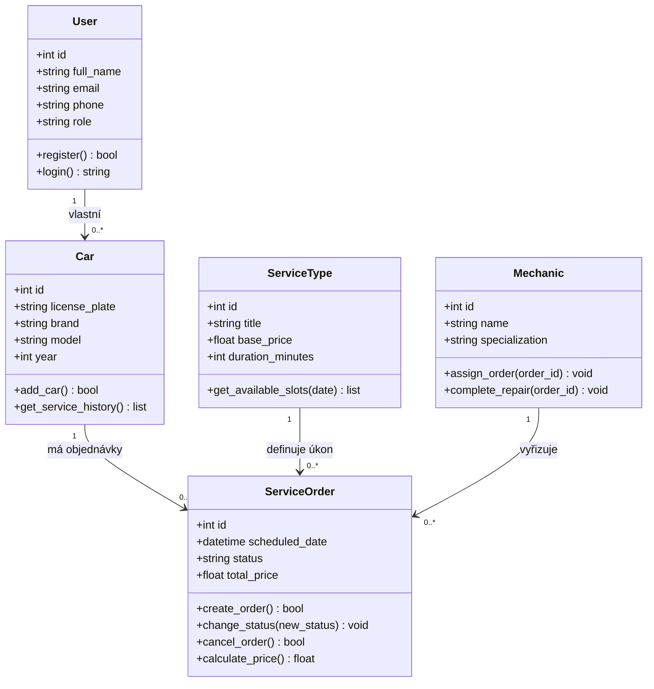
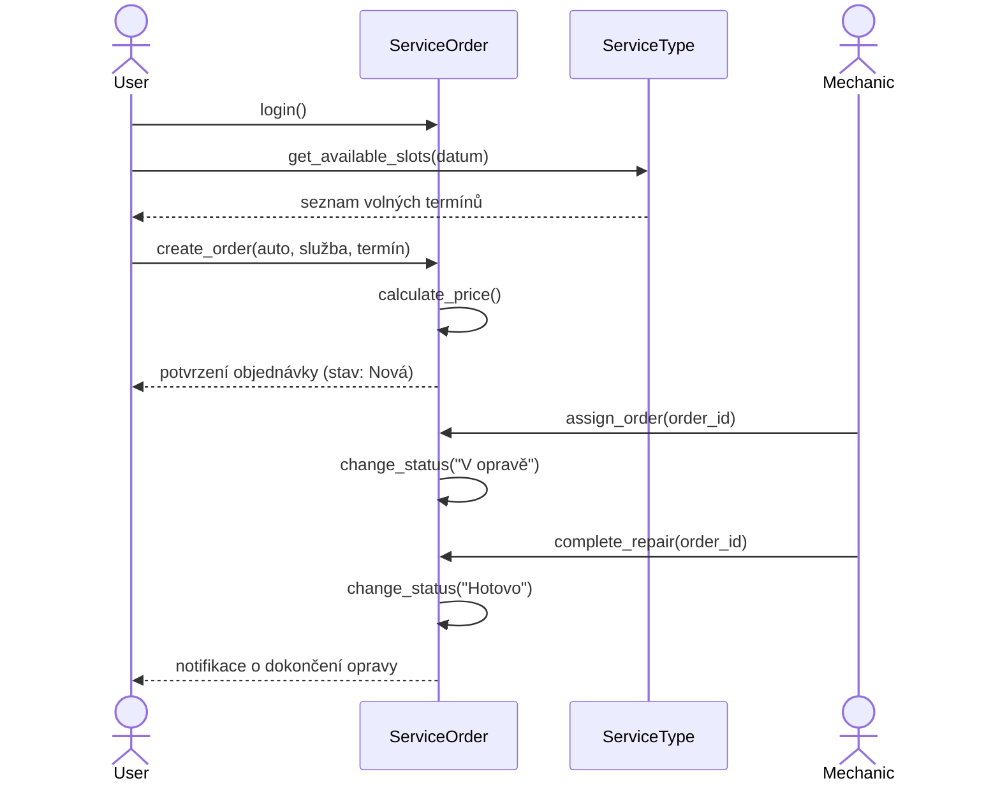

# LAB 2 – Návrh tříd a Workflow (AutoPoint)

## 1. Základní třídy a jejich funkcionalita (UML Class Diagram)

Systém obsahuje 5 hlavních tříd a celkem 11 metod:

### Popis hlavních funkcionalit:
1. **`register()` / `login()` (`User`)** – registrace zákazníka a přihlášení do systému.
2. **`add_car()` (`Car`)** – přidání vozidla podle SPZ do profilu uživatele.
3. **`get_available_slots()` (`ServiceType`)** – výpočet volných termínů podle délky úkonu.
4. **`create_order()` / `calculate_price()` (`ServiceOrder`)** – vytvoření objednávky a automatický výpočet ceny.
5. **`assign_order()` / `complete_repair()` (`Mechanic`)** – převzetí zakázky mechanikem a změna stavu opravy (`Nová` -> `V opravě` -> `Hotovo`).

---

## 2. Workflow systému (UML Sequence Diagram)

